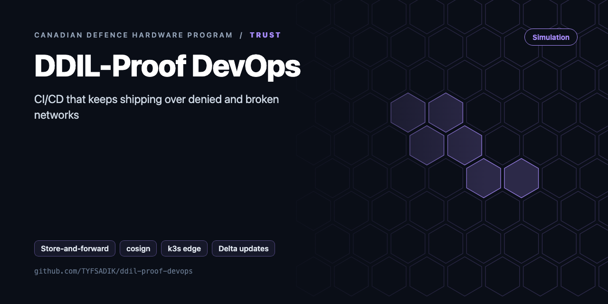
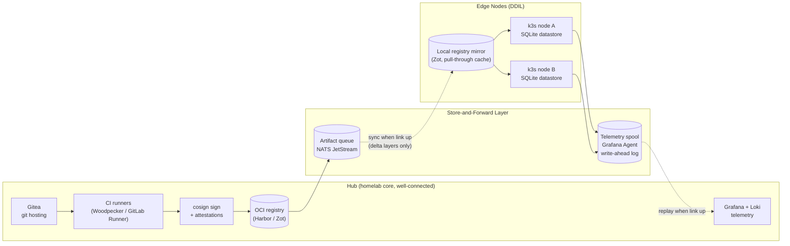

<div align="center">



# DDIL-Proof DevOps

**CI/CD and telemetry for denied, degraded, intermittent, limited networks: store-and-forward queues, delta updates, cosign-signed artifacts, k3s edge nodes.**

[](https://github.com/TYFSADIK/ddil-proof-devops/actions/workflows/tests.yml)   [](LICENSE) [](https://github.com/TYFSADIK/defence-hardware-program)

[Build guide](docs/project-page.md) · [How it works](#how-it-works) · [Quick start](#quick-start) · [Program hub](https://github.com/TYFSADIK/defence-hardware-program)

</div>

## Overview

Most CI/CD tooling assumes a reliable network: runners always reach the registry, agents always reach the control plane, telemetry always reaches the dashboard. That assumption fails exactly where the software matters most. **DDIL stands for denied, degraded, intermittent, and limited communications**, the network conditions faced by ships at sea, forward operating locations, disaster-response teams, and honestly my own homelab when the ISP has a bad day. This project is my attempt to build a deployment and observability pipeline that treats connectivity as a bonus, not a requirement.

The design has four pillars. **Store-and-forward queues** buffer commits, artifacts, and telemetry locally until a link appears. **Delta updates** ship only the changed layers of a container image instead of multi-gigabyte tarballs. **Cosign-signed artifacts** mean the edge node can verify supply-chain integrity offline, without phoning home to a transparency log. And **k3s edge nodes** run workloads autonomously with a local SQLite-backed datastore when the control plane is unreachable.

The part I care about most is proof. Resilience claims are cheap, so the whole system is tested with chaos engineering: `tc netem` to inject latency, jitter, and packet loss, and Toxiproxy to sever links between components on a schedule or at random. This mirrors exactly what deployed forces face at the edge, but everything here is a simulation in my homelab using open tooling. There is no weapons logic, no targeting, and nothing classified: it is plumbing, built and broken deliberately so the failure modes are understood before they matter.

## How it works



*The hub builds and signs artifacts; queues and spools bridge the DDIL gap to autonomous k3s edge nodes.*

## Quick start

```bash
make test
make build && ./bin/ddil keygen && ./bin/ddil manifest -name agent -version 1.0.0 -o v1.json bin/ddil
```

## What's in this repo

| Path | Purpose |
|---|---|
| `outbox/` | Durable store-and-forward queue: atomic write-then-rename, priority lanes (critical, normal, bulk), TTL expiry with counters, byte budget for metered links, full-jitter backoff |
| `delta/` | **Content-defined chunking** (Gear/FastCDC-style). A 20-byte insert into a 2 MiB file ships about 1 chunk instead of the whole file |
| `manifest/` | Release manifest (files, chunks, hashes) signed with Ed25519, plus an offline `cosign verify` wrapper for OCI images |
| `cmd/ddil` | CLI: `keygen`, `manifest`, `plan` (bytes that must cross the link), `verify` |
| `deploy/k3s-edge-agent.yaml` | Edge DaemonSet that pulls only from a local registry mirror |
| `deploy/tc-degrade.sh` | netem script that emulates a 256 kbit/s, 600 ms, 5% loss link for tests |

## What you need

| Category | Item | Notes |
|----|----|----|
| Hardware | Two or more machines or VMs for the hub and edge zones | A Raspberry Pi class board works for the edge; k3s is deliberately light |
| Software | k3s, NATS JetStream, Harbor (hub) plus Zot (edge), cosign, Grafana Agent, Loki, Prometheus, tc netem, Toxiproxy, Terraform + Ansible + Helm | All open source |
| Skills | Linux networking, container basics, Go or Python for the sync service | Comfort with firewall rules and packet capture helps when debugging the chaos runs |
| Accounts | None required | Keyless cosign signing uses the public Sigstore infrastructure; offline verification at the edge uses a self-managed key pair instead |

## Status

- **Done**: two-zone lab topology, k3s edge nodes, hub registry, cosign keyless signing pipeline, basic tc netem chaos scripts.
- **In progress**: JetStream artifact queue and edge mirror sync service, Grafana Agent write-ahead spooling, offline signature verification at the edge.
- **Next**: Toxiproxy scenario suite with scheduled random blackouts, resilience scorecard reporting, and full Terraform/Ansible codification of the edge build.

## Roadmap

- [ ] NATS JetStream transport for `outbox.Sender` (`nats.go`, a stream per priority lane, `Nats-Msg-Id` header = `Message.ID` for dedupe)
- [ ] Edge apply step: fetch missing chunks, `Assemble`, verify the manifest, atomic swap, health check, roll back on failure
- [ ] Measure on `tc-degrade.sh`: time to deliver a critical alert behind 10 MB of bulk logs, and update size vs full image
- [ ] Ansible playbook to bootstrap k3s and the registry mirror on the Pis

## Related builds

- [Secure Robot Fleet Updates](https://github.com/TYFSADIK/secure-fleet-updates), YubiKey-signed OTA with A/B rollback, the update half of the DDIL story.
- [Zero-Trust Air-Gapped Supply Chain](https://github.com/TYFSADIK/zero-trust-air-gapped-supply-chain), SBOM and cosign signing for artifacts before they ever reach the edge.
- [Decision Black Box](https://github.com/TYFSADIK/decision-black-box), tamper-evident audit logging for the human-in-the-loop decisions this pipeline supports.

## Learn more

The full build guide, with step-by-step instructions, wiring, troubleshooting and lessons learned, is in [docs/project-page.md](docs/project-page.md). It is also published at [tyfsadik.org](https://tyfsadik.org/work/defence/ddil-proof-devops.html).

## License

[MIT](LICENSE). Built by [Taki Sadik](https://tyfsadik.org) as part of the self-funded [Canadian Defence Hardware Program](https://github.com/TYFSADIK/defence-hardware-program).
