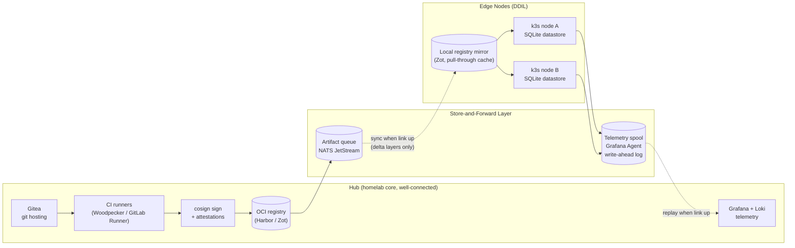
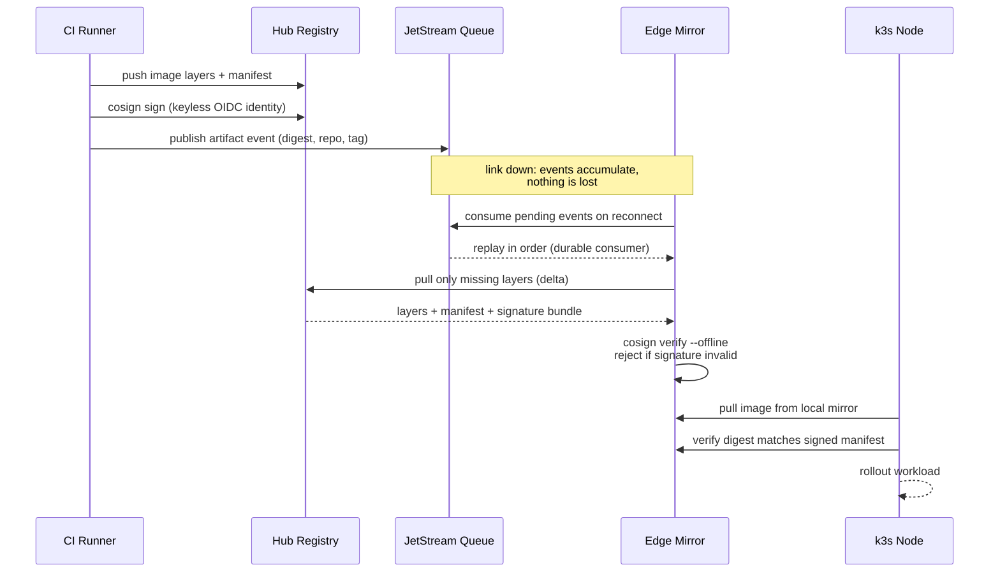

# DDIL-Proof DevOps

Written by [Taki Sadik](https://tyfsadik.org/about.html) · Last updated 2026-10-22 · Status: Building · 14 min read

A CI/CD and telemetry system that keeps working when the network does not: store-and-forward queues, delta updates, cosign-signed artifacts, and edge nodes running k3s, with resilience proven by simulating link loss through chaos engineering.

## Overview

Most CI/CD tooling assumes a reliable network: runners always reach the registry, agents always reach the control plane, telemetry always reaches the dashboard. That assumption fails exactly where the software matters most. **DDIL stands for denied, degraded, intermittent, and limited communications**, the network conditions faced by ships at sea, forward operating locations, disaster-response teams, and honestly my own homelab when the ISP has a bad day. This project is my attempt to build a deployment and observability pipeline that treats connectivity as a bonus, not a requirement.

The design has four pillars. **Store-and-forward queues** buffer commits, artifacts, and telemetry locally until a link appears. **Delta updates** ship only the changed layers of a container image instead of multi-gigabyte tarballs. **Cosign-signed artifacts** mean the edge node can verify supply-chain integrity offline, without phoning home to a transparency log. And **k3s edge nodes** run workloads autonomously with a local SQLite-backed datastore when the control plane is unreachable.

The part I care about most is proof. Resilience claims are cheap, so the whole system is tested with chaos engineering: `tc netem` to inject latency, jitter, and packet loss, and Toxiproxy to sever links between components on a schedule or at random. This mirrors exactly what deployed forces face at the edge, but everything here is a simulation in my homelab using open tooling. There is no weapons logic, no targeting, and nothing classified: it is plumbing, built and broken deliberately so the failure modes are understood before they matter.

## Architecture

Figure 1: the hub builds and signs artifacts; queues and spools bridge the DDIL gap to autonomous k3s edge nodes.

The dotted links are the ones that fail in testing, deliberately and often. When they are down, the hub keeps building and the edge keeps running; the queues simply grow. When a link returns, JetStream replays pending artifact references and the Grafana Agent's write-ahead log drains its spooled metrics and logs, so nothing built or observed during the outage is lost. The edge registry mirror is a pull-through cache, so a node that has never seen the hub can still start any workload its mirror has already fetched.

## Store-and-Forward Sync and Verification

Figure 2: the store-and-forward sync loop, with offline signature verification at the edge.

Two properties make this safe. First, the queue is a **durable consumer**: JetStream tracks exactly which events the edge mirror has acknowledged, so a crash mid-sync just resumes where it left off. Second, verification is **offline-capable**: cosign signatures and the Rekor inclusion proof are stored as OCI artifacts next to the image, so the edge mirror can run `cosign verify` against a local bundle without reaching the internet. An unsigned or tampered image never reaches a k3s node, even during an outage.

- **Delta updates**: registries deduplicate layers by digest, so syncing a new release usually moves megabytes, not gigabytes. For the worst case I am experimenting with `zot` sync policies and OCI artifact references to ship only changed blobs.
- **Backpressure**: when the spool grows past a threshold, telemetry degrades gracefully: metrics drop to longer scrape intervals and logs switch to sampling, instead of OOM-ing the edge node.
- **Ordering**: artifact events carry monotonic sequence numbers, so the mirror applies releases in order even if replay is bursty.

### Why NATS JetStream instead of Kafka here

Kafka is the heavier tool for this job: even with KRaft removing ZooKeeper, it is a JVM service sized for data-centre throughput. NATS JetStream gives the properties this design actually needs, disk-persisted streams, durable consumers with explicit acknowledgements, replay from any point, and retention policies, with optional RAFT replication when the topology allows it, in a single small binary that fits comfortably on an edge node. The tradeoff is deliberate: this queue carries artifact sync events and telemetry spooling, not millions of events per second, so the lighter system with the same durability semantics wins.

### What cosign actually proves

Cosign signs the image digest, the content hash of the container image, so verification answers one question: is this exactly the image the build pipeline produced? SBOM attestations travel alongside the signature as OCI artifacts, binding the bill of materials to the same digest. The Fulcio and Rekor keyless flow is the public-internet default, but for a disconnected edge the self-managed key pair is the right choice: the public key ships to the edge once, and verification needs no network at all. What this does not prove is that the image is safe to run, only that it is unmodified since signing. That distinction is why the signed artifact is a precondition for deployment, not a verdict on it.

## Stack

| Layer | Technology | Why |
|----|----|----|
| Edge orchestration | k3s (SQLite datastore) | Single binary, runs autonomous with no external etcd |
| Messaging / queueing | NATS JetStream | Durable store-and-forward, tiny footprint, offline-friendly |
| Artifact registry | Harbor at hub, Zot at edge | Pull-through caching and OCI-native sync policies |
| Supply-chain signing | cosign (Sigstore) | Offline verification with bundled Rekor proofs |
| Telemetry | Grafana Agent + Loki + Prometheus | Write-ahead log spools metrics and logs through outages |
| Chaos engineering | tc netem, Toxiproxy | Kernel-level and application-level link failure injection |
| Infrastructure as Code | Terraform + Ansible + Helm | Edge nodes reproducible from a USB stick and a git repo |

## How I'm Building It

### Step 01: Two-zone lab

The hub runs on my main homelab cluster. The "edge" is two small k3s nodes on a separate VLAN, so I can cut the link between zones with one firewall rule or a Toxiproxy toggle and watch what happens.

### Step 02: Signing pipeline

CI builds images and signs them with cosign using keyless OIDC identity, attaching the Rekor bundle to the registry so the edge never needs the transparency log online to verify.

### Step 03: Store-and-forward sync

A small Go service consumes JetStream artifact events and drives the Zot mirror sync. Durable consumers give at-least-once semantics plus idempotency: replay after an outage replays every unacknowledged event, the monotonic sequence numbers order them, and the sync service applies releases idempotently, so nothing is ever skipped and nothing is applied twice.

### Step 04: Spooled telemetry

Grafana Agent on each edge node writes metrics and logs to a local write-ahead log and remote-writes to Loki and Prometheus when the link is up. Disk-backed, restart-safe, and honest about what it has flushed.

### Step 05: Chaos harness

A test suite wraps `tc netem` (for example `tc qdisc add dev eth0 root netem delay 800ms 200ms loss 15%`) and Toxiproxy toxicity controls, running scheduled chaos scenarios: 30-minute blackouts, 2 kbps trickle links, 40% packet loss, then asserting that queues drain and signatures still verify.

### Step 06: Resilience scorecard

Each chaos run produces a report: max queue depth, time to catch up after reconnect, whether any workload restarted, whether any unsigned artifact was ever served. The scorecard is the deliverable, not the uptime claim.

## How Defence Could Implement This

The CAF operates exactly the environments DDIL describes: Arctic Forward Operating Locations, ships on Operation REASSURANCE or in the Indo-Pacific, and deployed headquarters on SATCOM links that degrade with weather and congestion. A pattern like this maps directly onto that reality:

- **Shipboard and forward k3s clusters**: lightweight Kubernetes at the edge runs local mission-support applications autonomously, receiving updates as delta-synced, signed artifacts whenever the link allows, instead of waiting for a port visit.
- **Assured software supply chain**: cosign verification at the edge means DND can prove that what runs on a forward node is exactly what was built and approved, even after weeks of disconnection, with a local audit trail.
- **Operations LENTUS and disaster response**: when domestic disaster relief knocks out terrestrial networks, store-and-forward telemetry keeps a common operating picture syncing between field nodes and command, filling in the gap retroactively as links recover.
- **NORAD modernization**: remote northern radar and sensor sites are the canonical intermittent-link case; local buffering plus opportunistic sync is the difference between losing telemetry and merely delaying it.
- **Test before trust**: chaos-engineered acceptance criteria (maximum tolerable outage, catch-up time, zero unsigned artifacts) give procurement and certification teams measurable resilience requirements instead of vendor promises.

Everything in this project is unclassified open tooling and simulation. The value it demonstrates is an engineering discipline, not a capability: assume the link dies, design for it, and prove the design by breaking it on purpose.

1.  **Stand up two zones.** A "hub" and an "edge" on separate networks or VMs. You cannot test disconnection until disconnection is a real thing you can do.
2.  **Put k3s on the edge.** A single-node install with the default SQLite datastore takes minutes and immediately teaches you what breaks when the control plane is remote.
3.  **Add a real registry and sign things.** Run Harbor or Zot, build a trivial image, and sign it with cosign. Verify it once online, then learn how to verify it offline with a bundled Rekor proof.
4.  **Insert a queue between hub and edge.** NATS JetStream is a single binary. Publish an event per artifact and write the smallest possible consumer that syncs your edge mirror.
5.  **Spool your telemetry.** Point Grafana Agent at a remote Loki/Prometheus, then unplug the link for an hour and confirm the write-ahead log replays cleanly.
6.  **Break the link on purpose.** Start gentle: `tc qdisc add dev eth0 root netem delay 500ms loss 5%`. Then graduate to full blackouts and Toxiproxy scenarios at random times.
7.  **Measure, do not vibes-test.** Record queue depth, catch-up time, and whether anything unsigned ever ran. If you cannot state a number, the resilience is not proven.
8.  **Codify everything.** Terraform, Ansible, and Helm from the start, so an edge node can be rebuilt from scratch during your next simulated outage.

**Scope and ethics:** this is a homelab simulation using only open-source tools and self-generated test traffic. There is no weapons logic, no targeting, no real operational data, and nothing classified. Chaos experiments run only against my own infrastructure.

## Status & Roadmap

- **Done**: two-zone lab topology, k3s edge nodes, hub registry, cosign keyless signing pipeline, basic tc netem chaos scripts.
- **In progress**: JetStream artifact queue and edge mirror sync service, Grafana Agent write-ahead spooling, offline signature verification at the edge.
- **Next**: Toxiproxy scenario suite with scheduled random blackouts, resilience scorecard reporting, and full Terraform/Ansible codification of the edge build.

### Designed vs Built vs Measured

| Subsystem | Designed | Built | Measured |
|----|----|----|----|
| Two-zone lab topology | Yes | Yes | Not applicable |
| k3s edge nodes | Yes | Yes | Not applicable |
| Hub container registry | Yes | Yes | Not applicable |
| Cosign signing pipeline | Yes | Yes | No signed-deployment metrics yet |
| JetStream artifact queue | Yes | In progress | No measured results yet |
| Edge mirror sync service | Yes | In progress | No measured results yet |
| Grafana Agent write-ahead spooling | Yes | In progress | No measured results yet |
| Offline signature verification at the edge | Yes | In progress | No measured results yet |
| Toxiproxy chaos scenarios | Yes | Basic `tc netem` scripts only | No completed resilience benchmark |

The lab, the k3s nodes, the registry, and the cosign pipeline exist and run. Queue sync, telemetry spooling, and offline verification are in progress, and no resilience benchmark has been completed yet, so the chaos claims above are protocols and targets.

## How I Built It

### Step 01: Two-zone lab

The hub runs on my main homelab cluster. The edge is two small k3s nodes on a separate VLAN, so the link between zones can be cut with one firewall rule or a Toxiproxy toggle. Disconnection is a real thing I can do, not a thought experiment.

### Step 02: Signing pipeline

CI builds images and signs them with cosign using keyless OIDC identity, attaching the Rekor bundle to the registry so the edge can verify signatures without reaching the transparency log online.

### Step 03: Artifact queue (in progress)

A small Go service consumes NATS JetStream artifact events and drives the Zot mirror sync. Durable consumers with monotonic sequence numbers give replay-after-outage semantics: a crash mid-sync resumes where it left off, never skipping a release.

### Step 04: Spooled telemetry (in progress)

Grafana Agent on each edge node writes metrics and logs to a local write-ahead log and remote-writes to Loki and Prometheus when the link returns. Disk-backed, restart-safe, and honest about what it has flushed.

### Step 05: Chaos harness (next)

tc netem for latency, jitter, and packet loss, plus Toxiproxy scenarios: 30-minute blackouts, 2 kbps trickle links, 40 percent packet loss. Then the resilience scorecard: max queue depth, time to catch up after reconnect, whether any workload restarted, whether any unsigned artifact was ever served.

## What You Need

| Category | Item | Notes |
|----|----|----|
| Hardware | Two or more machines or VMs for the hub and edge zones | A Raspberry Pi class board works for the edge; k3s is deliberately light |
| Software | k3s, NATS JetStream, Harbor (hub) plus Zot (edge), cosign, Grafana Agent, Loki, Prometheus, tc netem, Toxiproxy, Terraform + Ansible + Helm | All open source |
| Skills | Linux networking, container basics, Go or Python for the sync service | Comfort with firewall rules and packet capture helps when debugging the chaos runs |
| Accounts | None required | Keyless cosign signing uses the public Sigstore infrastructure; offline verification at the edge uses a self-managed key pair instead |

## Challenges and Lessons Learned

- **Keyless signing assumes the internet exists.** The edge cannot assume that, so the trust model is per side: keyless OIDC on the connected hub, a shipped-once public key with bundled Rekor proofs for offline verification at the edge. Choosing the trust model per side was the design decision; everything else followed.
- **Spooling telemetry can OOM a small edge node.** A long outage grows the write-ahead log past what the node can hold. The fix is graceful degradation: past a spool threshold, metrics drop to longer scrape intervals and logs switch to sampling instead of dying.
- **Ordered replay matters.** Artifact events carry monotonic sequence numbers so a bursty reconnect applies releases in order. Without that, a replay after a long outage could deploy releases out of sequence.
- **The queue choice was deliberate.** Kafka is sized for data-centre throughput; NATS JetStream gives durable streams and durable consumers in a single small binary that fits comfortably on an edge node. The queue carries sync events, not millions of messages per second, so the lighter system with the same durability semantics wins.
- **Chaos must be scheduled, not hand-run.** A tc netem one-liner proves a moment; the scorecard proves the system. The deliverable is the report, not the uptime claim.

## What Is Next

- Toxiproxy scenario suite with scheduled random blackouts.
- Resilience scorecard reporting after every chaos run.
- Full Terraform and Ansible codification so an edge node rebuilds from a USB stick and a git repo.
- Publish the first completed resilience benchmark as measured results. Until then, the chaos claims on this page are protocols and targets.

## Related Builds

- [Secure Robot Fleet Updates](https://github.com/TYFSADIK/secure-fleet-updates), YubiKey-signed OTA with A/B rollback, the update half of the DDIL story.
- [Zero-Trust Air-Gapped Supply Chain](https://github.com/TYFSADIK/zero-trust-air-gapped-supply-chain), SBOM and cosign signing for artifacts before they ever reach the edge.
- [Decision Black Box](https://github.com/TYFSADIK/decision-black-box), tamper-evident audit logging for the human-in-the-loop decisions this pipeline supports.

## Cite This Page

**Plain text**

    Taki Sadik, "DDIL-Proof DevOps", TYFSADIK, https://github.com/TYFSADIK/ddil-proof-devops (accessed 2026-10-22).

**BibTeX**

    @misc{sadik-ddil-proof-devops,
      author  = {Sadik, MD. Taki Yasir Faraji},
      title   = {DDIL-Proof DevOps},
      year    = {2026},
      url     = {https://github.com/TYFSADIK/ddil-proof-devops},
      urldate = {2026-10-22}
    }

**APA**

    Sadik, M. T. Y. F. (2026). DDIL-Proof DevOps. TYFSADIK. https://github.com/TYFSADIK/ddil-proof-devops

---

Original page: <https://github.com/TYFSADIK/ddil-proof-devops>
